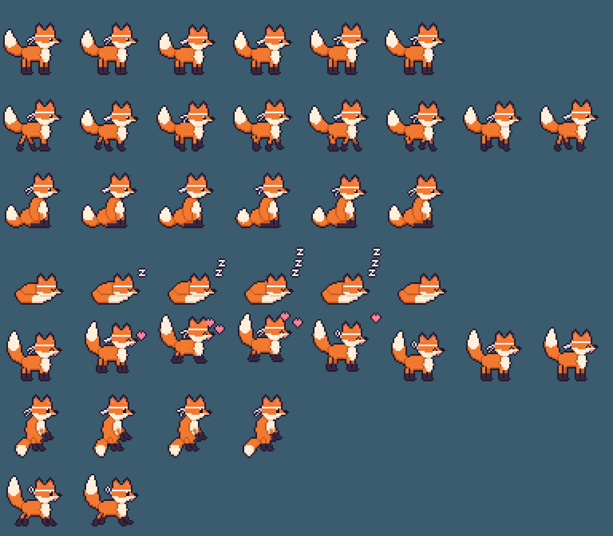

# Kata desktop mate

[](https://github.com/tomerba6/kata-desktop-mate/actions/workflows/ci.yml)

Kata is a pixel-art fox that will live on your Windows desktop: standing on the taskbar, wandering, sitting, napping, hopping when clicked, and riding on other windows.

Right now Kata lives along the bottom of your screen, in a window that doesn't look like one: no title bar, no border, no taskbar button, see-through around the fox and always on top. Left alone, it walks left and right, turning at the screen's edges, sits, and naps with Zs after a quiet spell. Click it and it hops with hearts, then carries on with what it was doing; a click on a napping Kata wakes it. Pick it up with the left button and it dangles by the scruff; let go and it falls and lands, or flick it and it flies, without ever leaving the screen. You can catch it in mid-air. Right-click it, then Quit, to close it. The rest gets built milestone by milestone in Claude Code. The roadmap is in [BRIEF.md](BRIEF.md).



## Quick start (PowerShell)

```powershell
py --version                                   # needs Python 3.14 or newer
py -m venv .venv
.venv\Scripts\python -m pip install -e ".[dev]"
.venv\Scripts\python -m kata                   # Kata on the desktop; right-click it, then Quit
.venv\Scripts\python -m kata.preview           # the sprite preview
.venv\Scripts\python -m pytest
.venv\Scripts\python -m ruff check .
.venv\Scripts\python -m mypy                   # types, strict
.venv\Scripts\python -m coverage run -m pytest # the tests again, measured
.venv\Scripts\python -m coverage report        # the 90% gate on the no-Qt modules
```

In the preview window, Left and Right switch animation, Space pauses and Esc quits.

CI runs ruff, mypy, the tests and the coverage gate on every push, on Python 3.14 and 3.15. The HTML coverage report and mutation testing (run by hand) are in the Commands list in [CLAUDE.md](CLAUDE.md).

Calling `.venv\Scripts\python` directly means you never have to activate the virtual environment, so PowerShell's script-execution policy can't get in the way.

## What's here

| Path | What it is |
| :-- | :-- |
| `BRIEF.md` | The roadmap: nine milestones, each built from its own plan in `docs/plans/` |
| `CLAUDE.md` | Project rules Claude Code reads at the start of every session |
| `src/kata/assets/kata.png` | The sprite sheet: 7 animations, 48x48 frames |
| `src/kata/assets/kata.json` | Which row is which animation, frame counts, speeds, the walk's stride |
| `src/kata/app.py` | Starts Kata: loads the frames, stands Kata on the floor, hands the window a brain, the clock, the desktop and the log. `python -m kata` runs it |
| `src/kata/window.py` | Kata's window: frameless, see-through, on top. Draws the current frame facing Kata's way, runs the tick (16 ms, about 60 Hz) that carries out what the brain decides, and handles clicks, picking up, carrying and throwing |
| `src/kata/brain.py` | Kata's brain: idle, walk, sit and sleep, how long each lasts and what comes next, the hop when clicked, and held and fall from the window's events. No Qt |
| `src/kata/body.py` | Kata's body: the feet point, walking, its speed in the air, gravity, landing, the screen edges. No Qt |
| `src/kata/drag.py` | One press of the mouse: a click or a drag, and how fast it was let go. No Qt |
| `src/kata/animator.py` | Which frame to show, from elapsed time; looping and one-shot animations. No Qt |
| `src/kata/geometry.py` | Where the window goes: the floor, the start spot, the window corner, the grip point and its mirror, the bounds, which screen Kata is on. No Qt |
| `src/kata/switches.py` | Developer switches such as `KATA_LOG`, and its log lines. No Qt |
| `src/kata/sheet.py` | Reads the JSON: frame size, ground line, animations, and the walking speed from the stride. No Qt |
| `src/kata/sprites.py` | Cuts the sheet into frames, and flips them for facing left |
| `src/kata/preview.py` | A plain window that plays each animation. `python -m kata.preview` runs it |
| `tests/test_animator.py`, `test_body.py`, `test_brain.py`, `test_drag.py`, `test_geometry.py`, `test_switches.py` | Tests for those six modules; the animator, body, brain and geometry ones include Hypothesis property tests, and the brain's include 180 seeded ten-minute runs |
| `tests/test_window.py` | Drives Kata's window headless, with a fake clock and made-up mouse events: carry, drop, throw, catch, a click and its hop, fast clicks, the screen edges, walking and turning, and ten minutes of Kata's own behaviour, with clicks in the first two minutes |
| `tests/test_sheet.py` | Checks that the JSON is read correctly |
| `tests/test_sprites.py` | Checks that the JSON matches the PNG, and that frames are cut, scaled and mirrored pixel for pixel |
| `tests/test_make_sprites.py` | Checks that the committed sheet is what `make_sprites.py` draws |
| `tests/test_no_qt.py` | Checks that the no-Qt modules import no Qt, and that the coverage gate and the mutation run cover exactly them |
| `tests/test_inspect_kata.py` | Checks the pure helpers of `inspect_kata.py` |
| `tests/conftest.py` | Puts Qt on its offscreen platform, so no test opens a window; the shared QApplication; runs the tests marked `slow` last; Hypothesis profiles, including the repeatable `ci` one |
| `tools/make_sprites.py` | Draws the sprite sheet from code |
| `tools/inspect_kata.py` | Measures Kata on the real desktop: window styles, focus, click-through, paws on the floor, CPU use. Read-only |
| `.claude/skills/run-kata/SKILL.md` | Tells Claude Code when and how to use `inspect_kata.py` |
| `docs/sprites-preview.png` | Enlarged contact sheet of every frame |
| `docs/plans/` | One plan per milestone, with its steps, decisions and session log |
| `.github/workflows/ci.yml` | CI: lint, types, tests and the coverage gate on every push |
| `cosmic-ray.toml` | Mutation testing settings, for runs by hand |

## Changing the art

The fox is drawn by `tools/make_sprites.py`: a hand-drawn head stamp plus simple shapes for body, legs and tail, moved a pixel or two per frame. Edit the head, the palette or a pose, then run:

```powershell
.venv\Scripts\python tools\make_sprites.py
```

It rewrites `kata.png`, `kata.json` and the preview image.
